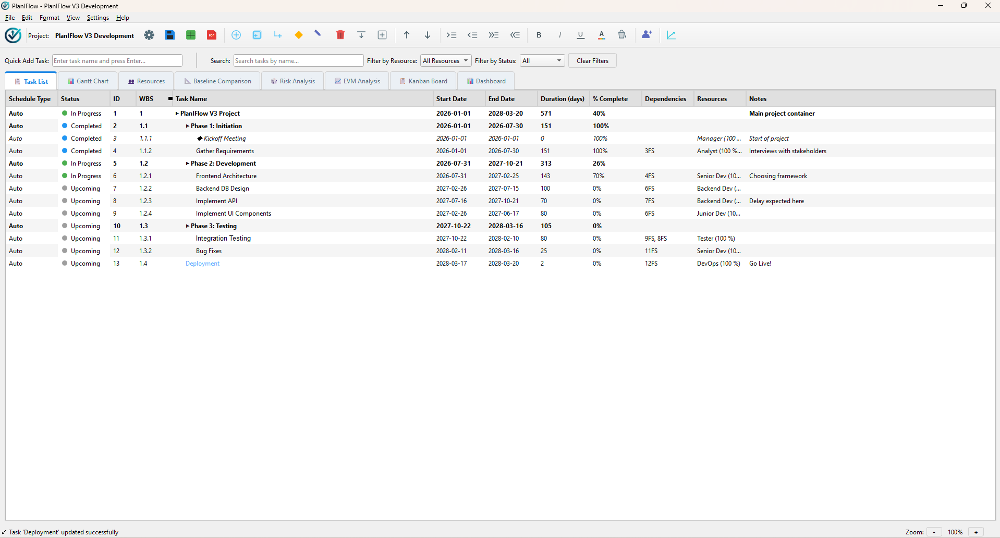
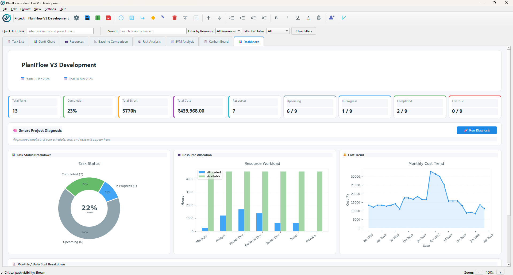
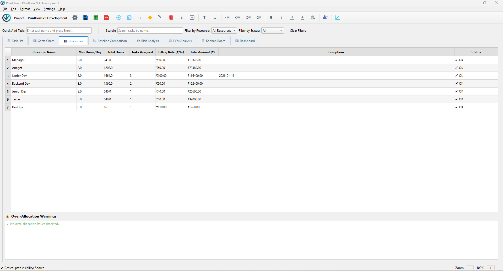

# 📊 PlanIFlow - Project Planner


PlanIFlow is an **Offline-First**, standalone desktop application for project planning and management, offering features similar to professional project management tools. It operates primarily offline, with optional network connectivity solely for secure updates.

## 📝 Table of Contents

- [Features](#features)
- [Technologies Used](#technologies-used)
- [Architecture Overview](#architecture-overview)
- [Getting Started](#getting-started)
  - [Prerequisites](#prerequisites)
  - [Running the Application](#running-the-application)
  - [Using Standalone Executables](#using-standalone-executables)
- [Usage](#usage)
  - [Creating a New Project](#creating-a-new-project)
  - [Adding Tasks and Resources](#adding-tasks-and-resources)
  - [Managing Tasks](#managing-tasks)
  - [Resource Exception Days](#resource-exception-days)
  - [Kanban Board](#kanban-board)
  - [Gantt Chart](#gantt-chart)
  - [Dashboard](#dashboard)
  - [Earned Value Management (EVM) Analysis](#earned-value-management-evm-analysis)
  - [Importing and Exporting Data](#importing-and-exporting-data)
  - [Project Baselining](#project-baselining)
- [Monte Carlo Risk Analysis](#monte-carlo-risk-analysis)
- [Screenshots](#screenshots)
- [Shortcuts](#shortcuts)
- [Batch Scripts](#batch-scripts)
- [Project Structure](#project-structure)
- [Troubleshooting](#troubleshooting)
- [License](#license)
- [Security and Distribution](#security-and-distribution)
- [Secure Auto-Update System](#secure-auto-update-system)
- [Acknowledgments](#acknowledgments)

## ✨ Features

- **Offline-First Architecture**: Your data stays on your machine. Network is used only for optional update checks.
- **Modular UI Architecture**: Well-organized PyQt6 user interface separating tasks, resources, baseline managers, risk analysis, EVM, and dashboards.
- **Project Settings Management**: Dedicated interface for configuring project-specific settings, working hours, non-working days, and preferences.
- **Task Management**: Create, edit, and delete tasks with standard dependency types (FS, SS, FF, SF + Lag/Lead times).
- **Bulk Add Tasks**: Quickly add multiple tasks at once by pasting a multiline list of task names (as top-level or subtasks).
- **Bulk Edit Tasks**: Update common properties (duration, completion %, predecessors, resources, notes) of multiple selected tasks simultaneously.
- **Hierarchical Tasks**: Summary tasks, sub-tasks, WBS tracking, indent (`Tab`) and outdent (`Shift+Tab`).
- **Inline Editing**: Directly edit task fields within the tree table for rapid modifications.
- **Context Menus**: Right-click context menus for quick actions (edit, delete, add subtask, indent/outdent, bulk edit).
- **Task Filtering & Search**: Filter tasks by resource, status, or search query.
- **Calendar & Holiday Management**: Custom work hours, work weeks, and recurring holidays automatically applied to project timelines.
- **Resource Management**: Manage labor/non-labor resources, max units, billing rates, and cost tracking.
- **Resource Allocation Tracking**: Track resource utilization and highlight over-allocation.
- **Resource Exception Days**: Specific dates or date ranges when resources are unavailable (leaves/vacations), excluding them from project schedules.
- **Multi-Currency Support**: Global setting for project-wide currency symbols (USD $, EUR €, GBP £, JPK ¥, INR ₹, etc.) reflected in dashboard metrics, cost tables, and reports.
- **Project Baselining**: Store up to 11 project snapshots per project. Compare active schedules against baselines to track date, duration, and cost variances.
- **Monte Carlo Risk Analysis**: Statistical simulation (up to 10,000 iterations) forecasting completion date distributions, confidence intervals (P50, P80, P90), and top risk driver tasks.
- **Earned Value Management (EVM)**: Industry-standard EVM metrics (PV, EV, AC, CPI, SPI, CV, SV, EAC, VAC) with automated plain-English health analysis and multi-sheet Excel export.
- **Smart Project Diagnosis**: Unified health check integrating Risk, Schedule, and EVM performance into an executive summary report.
- **Duration Unit Selection**: Switch between 'Days' and 'Hours' for granular task estimation.
- **Dynamic Gantt Charts**: Interactive timeline visualization with critical path highlights (red), zoom controls, milestone indicators, and interactive tooltips.
- **Interactive Kanban Board**: Visual task cards organized by status columns (To Do, In Progress, Delayed, Blocked, Completed) with drag-and-drop support, task-level, and resource-level filtering.
- **Rich Export Capabilities**: Export reports and charts to Excel, PDF, and JSON formats.
- **Undo/Redo Support**: Complete action history for project modifications.
- **Secure Auto-Update**: Background update checker with SHA-256 binary hash verification against official GitHub release records.
- **Dark Mode**: High-contrast dark theme support.

## 🛠️ Technologies Used

- **Python 3.11+**: Core programming language.
- **PyQt6 (v6.10.1)**: GUI framework and widgets.
- **Pandas (v2.3.3)**: High-performance data structures and analytical operations.
- **Matplotlib (v3.10.7)**: Gantt chart rendering and expense visual plots.
- **Openpyxl (v3.1.5)**: Advanced Excel report export with formatted sheets.
- **ReportLab (v4.4.5)**: Professional PDF document generation.
- **NumPy (v2.1.2)**: Numerical calculations and Monte Carlo distribution modeling.
- **Pillow (v13.0.0)**: Image manipulation and icon rendering.
- **Jsonschema (v4.23.0)**: Project JSON file structure and validation.
- **Python-dateutil (v2.9.0)**: Advanced calendar date calculations.
- **Requests (v2.33.0)**: Secure HTTPS communication (Updater module only).
- **cx_Freeze (v8.5.3)**: Application freezing and packaging.

## Architecture Overview

The application follows a clean modular architecture separating UI presentation, business rules, data persistence, and security controls:

```
[PyQt6 UI Layer] → [DataManager Models / Validators] → [Local I/O: JSON / Excel / PDF]
                               ↑
                 [Analytical Core: Monte Carlo / EVM / Gantt Engine]
                               ↓
[Update Manager] ← (Outbound HTTPS/TLS) → [GitHub Releases API]
```

- **Core**: Python 3.11+ with PyQt6 modular view management (`ui/`).
- **Data Layer**: In-memory data structures managed via `DataManager` (`data_manager/manager.py`) with strict validation via `ProjectValidator` (`data_manager/validator.py`).
- **Security**: Strict input validation limits, zero telemetry, local file-based storage, no database server listening ports.
- **Network**: Network access is strictly restricted to `updater/updater.py` for version checks and downloading installer updates over TLS.

## 🚀 Getting Started

### Prerequisites

- Windows 10/11 (or Linux/macOS for running from source)
- Python 3.11 or higher

### Running the Application

#### Windows:

Run the `run.bat` helper script, which sets up the virtual environment and installs dependencies if required:

```cmd
run.bat
```

#### Linux / macOS:

1. Create a virtual environment:
```bash
python3 -m venv venv
```

2. Activate the virtual environment:
```bash
source venv/bin/activate
```

3. Install dependencies:
```bash
pip install -r requirements.txt
```

4. Launch the application:
```bash
python3 main.py
```

### Using Standalone Executables

#### Windows (.msi Installer)

Download Code Verification Certificate: [Dipta Roy - Code Verification Certificate](https://github.com/dipta-roy/dipta-roy.github.io/blob/main/downloads/Code%20Verifying%20Certificates.zip).

**How to Trust Certificate:**
1. Download certificate from the link above.
2. Right-click `Signed_By_Dipta_CodeSigningPublicKey.cer` → "Install Certificate".
3. Select "Local Machine" (requires Administrator privileges).
4. Select "Place all certificates in the following store".
5. Click "Browse" → Select "Trusted Root Certification Authorities".
6. Click "Next" → "Finish".

**Verify Application Authenticity:**
1. Right-click `PlanIFlow_2.8.0.msi` (or executable) → Properties.
2. Open the **Digital Signatures** tab.
3. Select "Signed_By_Dipta" from the embedded signatures list and click **Details**.
4. Confirm the message states: *"This digital signature is OK."*

Execute `PlanIFlow_2.8.0.msi` to complete installation.

## 💻 Usage

### Creating a New Project

- Click `File > New Project` (`Ctrl+N`) to initialize a clean project workspace.
- Set project details, working hours, and currency via `Settings > Project Settings`.

### Adding Tasks and Resources

- **Add Resource**: Click `👤 Add Resource` in the toolbar to manage team members, roles, and rates.
- **Add Task**: Click `➕ Add Task` (`Ctrl+T`) to add an individual task.
- **Bulk Add Tasks**: Use `📑 Bulk Add Tasks` (`Ctrl+Shift+D`) to paste multiline task lists.
- **Sub-tasks**: Select a task and click `➕ Add Subtask` (`Ctrl+Shift+T`).

### Managing Tasks

- **Inline Editing**: Double-click any cell in the task table to edit inline.
- **Bulk Edit Tasks**: Select multiple task rows, right-click, and select **✏️ Bulk Edit Selected Tasks...**.
- **Hierarchy Management**: Use `Tab` (Indent) and `Shift+Tab` (Outdent) to structure summary tasks.
- **Task Formatting**: Apply styling using `Ctrl+B` (Bold), `Ctrl+I` (Italics), `Ctrl+U` (Underline).

### Resource Exception Days

- Define resource-specific exceptions (holidays, leaves, unavailability) in the Resource Manager.
- Supports single dates and multi-day date ranges.
- Exception days automatically adjust scheduling calculations for assigned tasks.

### Kanban Board

The **Kanban Board** tab provides an interactive task visualization:
- **Columns**: 📝 To Do, 🚀 In Progress, ⚠️ Delayed, 🚫 Blocked, ✅ Completed.
- **Task Cards**: Display task WBS, name, dates, completion %, resources, and notes.
- **Filters**: Filter cards by view scope (All, Tasks Only, Summary Only) or by specific assigned resource.

### Gantt Chart

- Interactive timeline visualization of all project activities.
- Toggle **Show Critical Path** to highlight zero-slack tasks in red.
- Zoom in (`Ctrl++`) and Zoom out (`Ctrl+-`) for day/week/month timeline views.

### Dashboard

- Key performance indicators (Total Cost, Task Counts, Progress %).
- **Smart Project Diagnosis**: Plain-English health report synthesizing risk, schedule, and cost performance.
- Cost distribution visual charts and resource expense breakdowns.

### Earned Value Management (EVM) Analysis

- Calculates PV (Planned Value), EV (Earned Value), AC (Actual Cost), CPI, SPI, CV, SV, EAC, and VAC.
- Displays plain-English project health explanations.
- Multi-sheet Excel report generator for executive reporting.

### Importing and Exporting Data

- **JSON**: Native high-fidelity format (`.json`).
- **Excel**: Standard `.xlsx` export for external stakeholders.
- **PDF**: Publication-ready project status and Gantt reports.

### Project Baselining

- Store up to 11 baselines per project (`Settings > Baselines > Set Baseline...`).
- Compare active project metrics against historical baselines in the **Baseline Comparison** dialog.

## 🎲 Monte Carlo Risk Analysis

Simulate potential schedule variations under uncertainty:
1. Open the **Risk Analysis** tab.
2. Select iteration count (e.g., 1000 or 10,000).
3. Click **Run Analysis** to generate confidence metrics (P50, P80, P90) and identify critical risk driver tasks.

## 📷 Screenshots

| Task List | Edit Task |
| --- | --- |
|  |  |

| Gantt Chart | Gantt Chart With Critical Path |
| --- | --- |
|  |  |

| Dashboard | Resource |
| --- | --- |
|  |  |

| Project Baseline | Set Project Baseline |
| --- | --- |
|  |  |

| Risk Analysis | EVM Analysis |
| --- | --- |
|  |  |

| Kanban Board | Edit Kanban Tile |
| --- | --- |
|  |  |

| Project Settings | Calendar Settings |
| --- | --- |
|  |  |

| Holidays Settings | Interface Settings |
| --- | --- |
|  |  |

## ⌨️ Shortcuts

| Shortcut | Action |
| --- | --- |
| `Ctrl+T` | Add Task |
| `Ctrl+Shift+D` | Bulk Add Tasks |
| `Ctrl+M` | Add Milestone |
| `Ctrl+Shift+T` | Add Subtask |
| `Ctrl+N` | New Project |
| `Ctrl+O` | Open Project |
| `Ctrl+S` | Save Project |
| `F5` | Refresh All Views |
| `Tab` | Indent Selected Task |
| `Shift+Tab` | Outdent Selected Task |
| `Space` | Toggle Expand / Collapse |
| `+` | Expand Selected Item |
| `-` | Collapse Selected Item |
| `Ctrl+B` | Bold Format |
| `Ctrl+I` | Italic Format |
| `Ctrl+U` | Underline Format |
| `Ctrl+Z` | Undo Action |
| `Ctrl+Y` | Redo Action |
| `Ctrl++` | Zoom In (Gantt Chart) |
| `Ctrl+-` | Zoom Out (Gantt Chart) |

## 🪟 Batch Scripts

| Script | Purpose |
| --- | --- |
| `run.bat` | Launches PlanIFlow, initializing virtual environment and dependencies if needed. |
| `build.bat` | Compiles the standalone application executable using cx_Freeze. |
| `build_msi.bat` | Generates the signed Windows MSI installer package. |
| `build_SingleExe.bat` | Compiles a single executable distribution. |
| `clean.bat` | Removes build output directories (`build/`, `dist/`, cached artifacts). |
| `launch_build_tool.bat` | Launches the GUI Build Automation Tool (`build_automation_gui.py`). |
| `run_security_scans.bat` | Executes security audit utilities (`bandit`, `pip-audit`, `vulture`, `xenon`). |

## 📂 Project Structure

| Path | Description |
| --- | --- |
| `main.py` | Application main entry point and application initialization. |
| `constants/` | Global application constants, theme color specs, and layout definitions. |
| `data_manager/` | Core data model, scheduling engine, validator, baseline, EVM, and Monte Carlo engine. |
| `ui/` | PyQt6 custom widgets, views (Gantt, Kanban, Dashboard, EVM, Risk), tree managers, and dialogs. |
| `calendar_manager/` | Working day logic, custom work hours, and holiday calculations. |
| `settings_manager/` | Application preferences and persistent configuration manager. |
| `exporter/` | Excel (`exporter.py`) and ReportLab PDF (`pdf_exporter.py`) reporting modules. |
| `updater/` | Secure HTTPS update checker and SHA-256 installer verifier. |
| `installer/` | MSI installer build definitions (`setup_msi.py`), sign scripts, and hash generator. |
| `tests/` | Unit and integration tests (`pytest`). |

## 🐛 Troubleshooting

- **App does not start**: Ensure Python 3.11+ is installed and in your system `PATH`.
- **Missing Module Error**: Run `pip install -r requirements.txt`.
- **Resource path issues when frozen**: Handled automatically via `sys._MEIPASS` and executable base directory detection.

## 📄 License

This project is licensed under the MIT License. See the [LICENSE](LICENSE) file for details.

## 📈 Security and Distribution

- **Formal Security Assessment**: [Full Security Report](https://github.com/dipta-roy/PlanIFlow/blob/main/SECURITY.md) – **Low Risk** (Secure Design).
- **VirusTotal Scan**: [VirusTotal Report](https://www.virustotal.com/gui/file/2b437fd3b2d6b627d79542de9487cdcf42e5f0e48ada15694e9c256f5bc6882a)
- **Offline-First**: Zero external network transmission of user project data.
- **Secure Auto-Update**: TLS/HTTPS communication with mandatory SHA-256 checksum matching.
- **Input Limits**: Enforces `MAX_TASKS = 10,000` and `MAX_STR_LEN = 250` via `ProjectValidator`.

## 🔄 Secure Auto-Update System

PlanIFlow features a built-in auto-update system:
1. **Check**: Queries official GitHub release endpoint (`api.github.com`) over HTTPS.
2. **Download**: Downloads the release `.msi` binary package.
3. **Verify**:
   - Calculates local SHA-256 hash of the downloaded installer.
   - Compares with the official release `sha256.txt` record.
   - Aborts installation immediately if hashes do not match.
4. **Install**: Executes `msiexec` to launch update installer.

**Manual Check**: Select **Help > Check for Updates**.

## 🙏 Acknowledgments

- Icons: [Flaticon](https://flaticon.com).
- Built with PyQt6, Matplotlib, Pandas, ReportLab, and Python communities.

Built by [Dipta Roy](https://dipta-roy.github.io) with ❤️.
